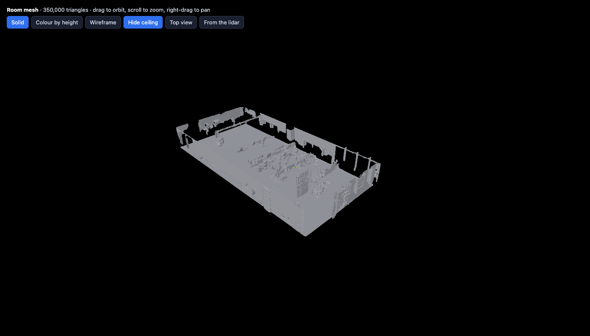
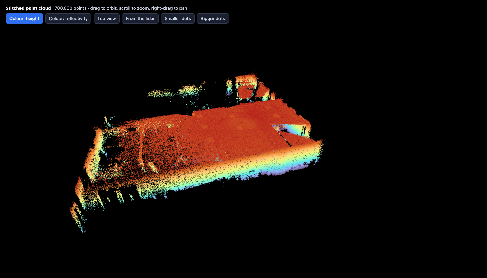
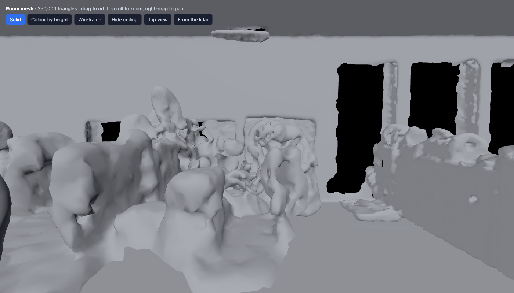
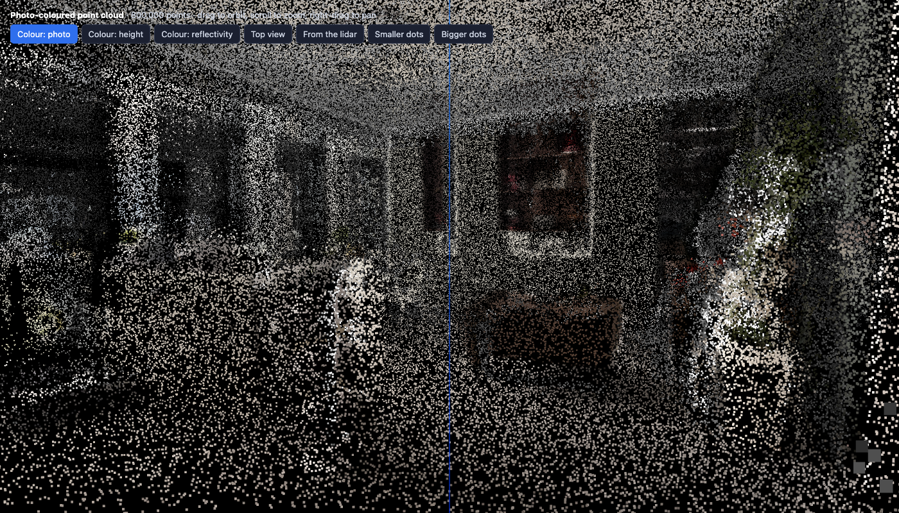
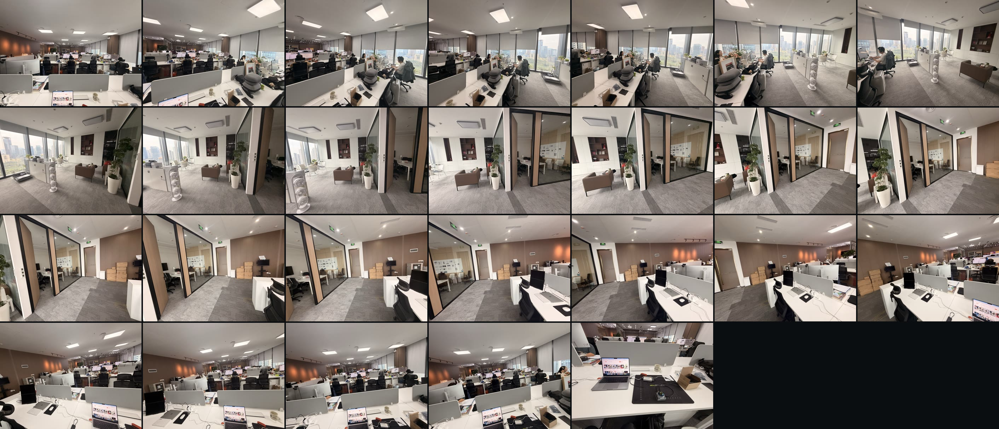
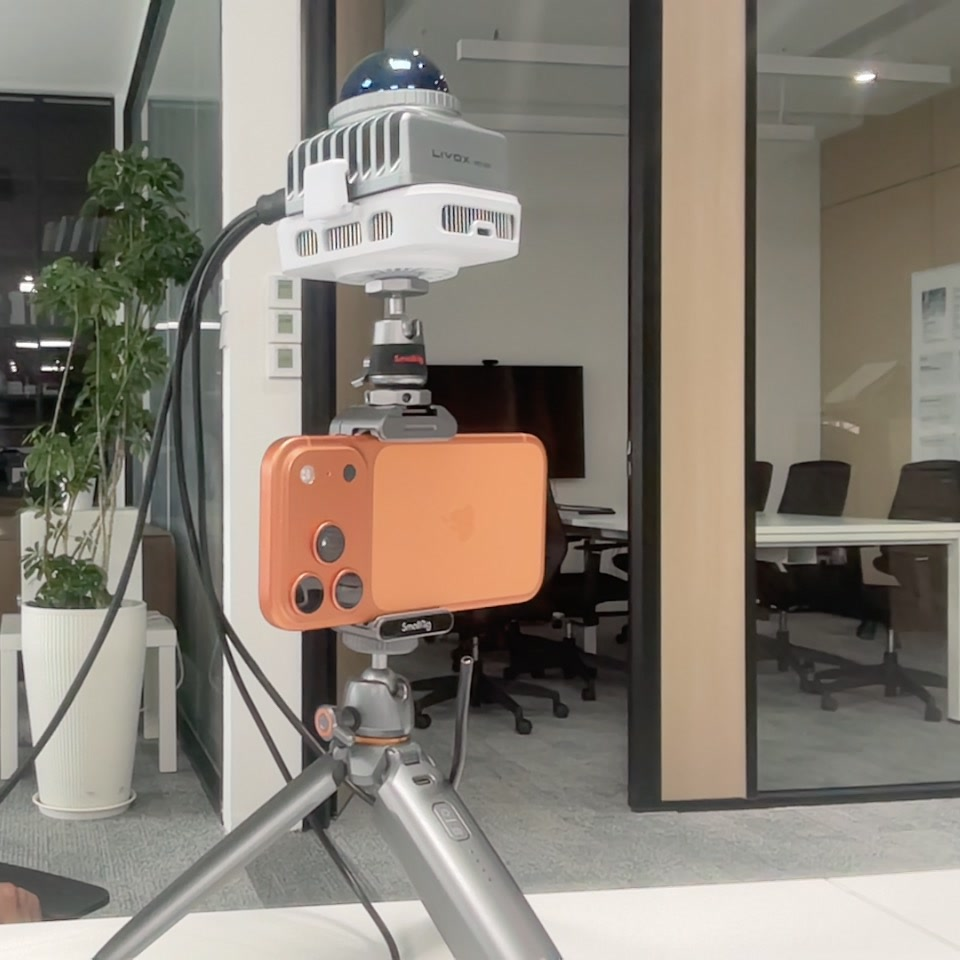

# Livox Mid-360 on a Mac: from first packet to a room mesh

Small Python scripts that talk to a Livox Mid-360 lidar directly over Ethernet, with no Livox SDK and no ROS.
They were written in one sitting on a MacBook to go from "is the sensor alive?" to a cleaned 3D mesh of a room.


*The whole setup: a MacBook, a Thunderbolt-to-Ethernet adapter (centre) and the Mid-360 (front), powered from
its own supply. No other hardware is involved.*

**[Open the interactive 3D viewers](https://prasanthsasikumar.github.io/livox-mid360-mac/)** (drag to orbit, scroll to zoom).

[](https://prasanthsasikumar.github.io/livox-mid360-mac/room-mesh.html?ceiling=off)

The example is a hall of about 10 m by 21.5 m with a 3.1 m ceiling. It was scanned in 75 seconds by lifting
and tilting the lidar around a table top; the lidar never left the table area.

| Stitched cloud, coloured by height | Mesh, seen from the lidar's position |
|---|---|
| [](https://prasanthsasikumar.github.io/livox-mid360-mac/cloud.html) | [](https://prasanthsasikumar.github.io/livox-mid360-mac/room-mesh.html?view=in) |

| Coloured from 26 iPhone photos | Seen from above |
|---|---|
| [](https://prasanthsasikumar.github.io/livox-mid360-mac/colour-cloud.html?view=in) | [](https://prasanthsasikumar.github.io/livox-mid360-mac/colour-cloud.html) |

| Top-down density of the stitched cloud | Cleaned room cloud from above |
|---|---|
|  | [](https://prasanthsasikumar.github.io/livox-mid360-mac/room-cloud.html?view=top) |

## What you need

- A Livox Mid-360, powered, connected to the computer by Ethernet (a USB or Thunderbolt adapter is fine).
- The computer's wired port set to a fixed address on the lidar's network. The scripts assume `192.168.1.50`
  for the computer and `192.168.1.119` for the lidar; pass `--host` and `--lidar` if yours differ. A factory
  Mid-360 is at `192.168.1.1XX`, where `XX` is the last two digits of its serial number.
- Python 3.9 or newer. The first three scripts use only the standard library. The rest need the packages in
  `requirements.txt`:

  ```sh
  python3 -m venv .venv
  .venv/bin/pip install -r requirements.txt
  ```

Developed and run on macOS (Apple silicon). Nothing is Mac-specific except the `open` command used to launch
the viewer, which you can skip with `--no-open`.

## The scripts, in the order you would use them

| Script | What it does | Needs |
|---|---|---|
| `livox_probe.py` | Tells the lidar where to send data, starts it, and counts points and motion-sensor packets for a few seconds. A health check. | standard library |
| `livox_cloud.py` | Captures a few seconds with the lidar standing still and writes a 3D viewer, a `.ply` and a top-down `.png`. | standard library |
| `livox_record.py` | Saves every raw point and motion-sensor packet to a file while you move the lidar. | standard library |
| `livox_theta.py` | Takes 360 photos on a USB-connected RICOH THETA; `livox_record.py --theta` uses it. | `gphoto2` |
| `livox_stitch.py` | Works out how the lidar moved during a recording and merges all scans into one cloud. | `requirements.txt` |
| `livox_room.py` | Crops a stitched cloud to the room the lidar was in, adds a flat floor, flattens walls and ceiling, removes stray points. | `requirements.txt` |
| `livox_mesh.py` | Turns a cloud into a surface mesh and writes a mesh viewer. | `requirements.txt` |
| `livox_view.py` | Makes a point-cloud viewer from any `.ply` these scripts wrote. | `requirements.txt` |
| `livox_photos.py` | Works out where a set of ordinary photos was taken inside a stitched cloud. | `requirements.txt` |
| `livox_colour.py` | Paints the lidar points with the colours from those photos. | `requirements.txt` |

### 1. Check the sensor

```sh
python3 livox_probe.py
```

A healthy Mid-360 reports about 200,000 points per second, 200 motion-sensor packets per second, an
acceleration close to 1 g when it is sitting still, and roughly 23 Mbit/s of data. Add `--standby` to stop the
motor afterwards.

The Mid-360 sends nothing until a program tells it where to send. The destination address is written into the
lidar, so the next computer you plug it into has to set its own.

### 2. A still scan

```sh
python3 livox_cloud.py --seconds 3
```

Output goes to `scans/`. Three seconds gives about 470,000 points. Keep the lidar still: nothing in this script
corrects for movement.

### 3. Record while moving

```sh
python3 livox_record.py --seconds 75
```

The status line counts down a few seconds of `STAND STILL`, then says `WALK`. Recordings go to `recordings/`
at about 170 MB per minute. They hold the raw packets, so one recording can be re-stitched with different
software or settings later.

How to move:

- Start with the lidar resting on something, untouched, for the still phase.
- Move slowly. Take 2–3 seconds for a quarter turn, and go through doorways slowly.
- Hold it by the base, keep hands and body away from the dark window, and keep other people out of view.
- Changing height and tilting it gently (up to about 30°) is what lets it see the floor and fill the blind
  cone directly above it.
- Finish where you started. The stitcher prints the start-to-end gap, which is then your drift.

Add `--phone` to film on an iPhone at the same time, or `--theta` to take 360 photos on a RICOH THETA (see the
rigs below).

### 4. Stitch

```sh
.venv/bin/python livox_stitch.py            # newest recording
.venv/bin/python livox_stitch.py --method lio
```

Two methods are available:

- `icp` (default) uses [KISS-ICP](https://github.com/PRBonn/kiss-icp): points only.
- `lio` uses [RKO-LIO](https://github.com/PRBonn/rko_lio): points plus the motion sensor. It needs the lidar to
  be completely still at the start.

On the one moving recording made so far, `icp` gave the sharper map, and that recording did not have a still
start, so this is not a fair verdict on `lio`. Neither method has loop closure, so long walks will drift.

After stitching, the map is levelled on its largest flat horizontal surface, so it comes out upright even if
the lidar was in your hand at the start.

### 5. Crop to the room and clean up

```sh
.venv/bin/python livox_room.py
```

It finds the strongest wall on each side of the lidar and treats that rectangle as the room. If it picks the
wrong walls, give them yourself with `--box XMIN XMAX YMIN YMAX`. Flattening moves every point within 10 cm of
a wall or 18 cm of the ceiling onto that surface, which removes sensor noise and also any real detail of that
size. `--close` additionally fills in the ceiling and all four walls, covering real doorways and windows.

### 6. Mesh

```sh
.venv/bin/python livox_mesh.py scans/<name>-stitched-room.ply --smooth 8 --trim 0.02
```

Poisson surface reconstruction with Open3D, trimmed back to where there are real points, with small loose
pieces removed. The viewer has a "Hide ceiling" button for looking into the room from above.

### 7. Colour from photos (optional)

```sh
.venv/bin/python livox_photos.py "~/Downloads/office images" scans/<name>-stitched.ply --name office
.venv/bin/python livox_colour.py scans/<name>-stitched.ply --photos photos/office
```

The lidar has no camera, so colour comes from separate photos, here 26 iPhone ultra-wide shots.
`livox_photos.py` reconstructs the camera positions from the photos alone with
[COLMAP](https://colmap.github.io/) (about 10 minutes for 26 photos), then fits that reconstruction onto the
lidar cloud: up from the floor, scale from an assumed camera height of 1–2 m, heading and position by sliding
one floor plan over the other, then a fine 3D fit. It prints how good the fit is; in the example 68% of the
photo points landed within 8 cm of a lidar surface.

`livox_colour.py` then projects every lidar point into every photo and takes the colour, skipping points that
are hidden behind nearer ones. Points no photo sees stay grey. The viewer gains a "Colour: photo" button.

The example photo set is in `photos/office/images`, with its reconstruction in `photos/office/sfm` and the
fitted placement in `photos/office/sfm_to_lidar.npy`. The full coloured result (2.9 million points with RGB) is
`examples/office-colour.ply`, which opens in CloudCompare or MeshLab, or with `livox_view.py`.



Photo tips: heavy overlap between neighbouring shots, one lens and no zoom changes, even light, and some floor
in view. Walking around gives the best coverage; a handheld spin on the spot also worked here, and colours
only what is visible from that spot (54% of the points in the example).

## A handheld rig with a phone

For colour, the lidar and a phone go on one handle: lidar on top with a clear view all round, phone in
landscape below it, one cable down to the computer and a 12 V supply.

| The idea | Built from a mini tripod, a phone clamp and two ball heads |
|---|---|
|  |  |

There is no sync wiring. The phone's pictures are placed in the lidar scan afterwards by matching what they
see (step 7), so the phone only has to stay put and take sharp pictures. Things that matter:

- Nothing may stick up beside the lidar's dome, and the phone and clamp stay below its base.
- Route the cable behind the handle so it stays out of the phone's pictures, and tie it down.
- The lidar's body is its heat sink: leave the fins open, and print any adapter in PETG or ABS, not PLA.
- Lock the phone's exposure, focus and white balance, and turn off stabilisation modes that crop the picture.

### Triggering the phone from the computer

`phone-app/` is LidarCam, a small iPhone app that records 4K video and is driven from the computer, so nobody
has to touch the phone on the rig:

```sh
python3 livox_record.py --seconds 75 --phone
```

That starts the phone and the lidar together, stops both, and downloads the clip into `recordings/` next to the
lidar file, with a `.phone.json` holding the camera settings and the clock difference between phone and
computer (measured to a few hundredths of a second), so video frames can be matched to lidar time.

- The app locks white balance and exposure, uses a shutter of 1/200 s or faster when the light allows, turns
  stabilisation off, tags the video the right way up for however the phone is mounted, and keeps the screen on.
- `--lens ultrawide` (default) sees the most and is sharp at every distance, so focus is locked. `--lens wide`
  gives more detail but has a shallow depth of field indoors, so it keeps autofocusing.
- Phone and computer must be on the same Wi-Fi with the app open. If the phone is out of range when the
  recording ends, the clip stays on the phone; `python3 livox_phone.py stop` and `fetch` collect it later.
- `livox_phone.py` also works on its own: `status`, `start NAME`, `stop`, `list`, `fetch FILE`.

To build the app you need Xcode, [XcodeGen](https://github.com/yonaskolb/XcodeGen) and an Apple developer
account: copy `phone-app/Local.xcconfig.example` to `Local.xcconfig`, fill in your team and a bundle id, then
`cd phone-app && xcodegen generate` and build to your phone from Xcode. Allow camera and local-network access on
first launch.

Checked so far: short combined recordings standing still (4K clip fetched, no lidar packets lost). A full
walking capture with the rig has not been processed yet.

## A handheld rig with a 360 camera

The second rig drops the phone for a RICOH THETA Z1, which takes the whole sphere in one photo. Everything sits
on one mini tripod: legs closed as the handle, a ball head, the Mid-360 on its side in a cage with the dome
facing out, a second ball head, and the THETA on top.

| The idea | As built |
|---|---|
|  |  |

Turning the lidar on its side turns its 360° band upright, so it sees the floor and ceiling ahead as well as
the walls, without having to tilt the rig. The stitcher levels the map from gravity measured during the
stand-still at the start, so a sideways lidar still gives an upright map. The THETA, the ball heads and the
tripod are inside the lidar's band at close range and show up as a small blob around the start of the path.

```sh
brew install gphoto2
python3 livox_theta.py status                              # is the camera there?
python3 livox_record.py --seconds 60 --theta               # one 360 photo at the start
python3 livox_record.py --seconds 120 --theta --theta-every 15   # and one every 15 s
```

Photos land next to the recording as `walk-<time>.theta-00.jpg`, `-01.jpg` and so on (6720 × 3360,
equirectangular), with a `.theta.json` giving the computer time each one was triggered and downloaded. The
camera's clock is set to the computer's each time it connects.

- Plug the THETA in by USB-C, switch it on, still-photo mode. macOS grabs any newly plugged camera for its own
  photo import (`ptpcamerad`); the script stops that service before each command, and it restarts on its own.
- A photo takes about 11 s from trigger to download, so `--theta-every` shorter than that just shoots back to
  back. The exposure happens in the first second or two: pause while it shoots.
- The THETA can sit tilted (to make room for the cable, say). It levels its own photos with its gravity
  sensor, so the horizon comes out straight either way.
- Shooting happens in the background, so no lidar packets are lost while the camera works.

Checked so far: a 20 s test recording on a desk with two 360 photos, no lidar packets dropped, and the
stitched map level (floor and ceiling flat). Placing 360 photos in the scan and colouring from them is not done
yet: step 7 only handles ordinary photos.

## What to expect from the results

- Walls, floor, ceiling and large furniture come out well and to scale.
- The Mid-360's range noise is 2–3 cm, so surfaces are correct in shape and a little lumpy. Small objects and
  anything close to the lidar turn into blobs.
- A scan from one area only sees what is in line of sight from there. In the example, between 49% and 82% of
  each wall was seen; the gaps are behind furniture. Walking the room is the fix.
- There is no colour. The lidar measures distance and reflectivity only.

## Notes on the protocol

The command frame, checksums, parameter keys and ports were read from
[Livox-SDK2](https://github.com/Livox-SDK/Livox-SDK2) (`sdk_core/comm/sdk_protocol.cpp`,
`sdk_core/comm/define.h`, `include/livox_lidar_def.h`):

- Commands go to UDP port 56100 on the lidar. Points arrive on 56301 and motion-sensor data on 56401.
- A frame is a 24-byte header (start byte `0xAA`, length, sequence number, command id, CRC-16/CCITT-FALSE of
  the first 18 bytes, CRC-32 of the payload) followed by a list of key/value parameters.
- Command `0x0100` writes parameters: keys `0x0005` to `0x0007` set where status, points and motion-sensor
  data are sent, and key `0x001A` sets the work mode (1 = scanning, 2 = standby).
- Each data packet has a 36-byte header with the lidar's own nanosecond timestamp, then 96 points of 14 bytes
  each (x, y, z in millimetres, reflectivity, tag).

The viewers load [three.js](https://threejs.org/) from a CDN, so they need an internet connection.

## Known limits

- Tested with one Mid-360 on one Mac.
- The lidar's clock is not synchronised to anything; timestamps count from power-on.
- The mesher runs Poisson reconstruction on a single thread, because the multi-threaded version in Open3D 0.20
  crashed on this data.
