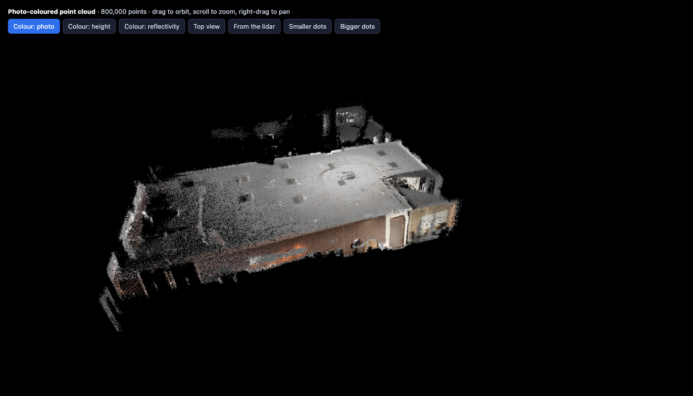
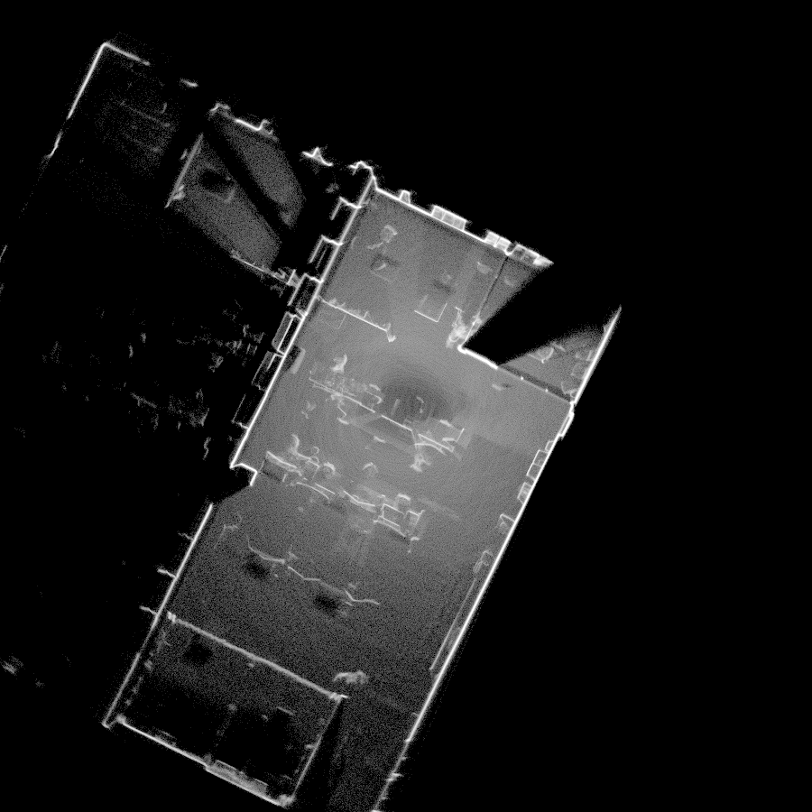
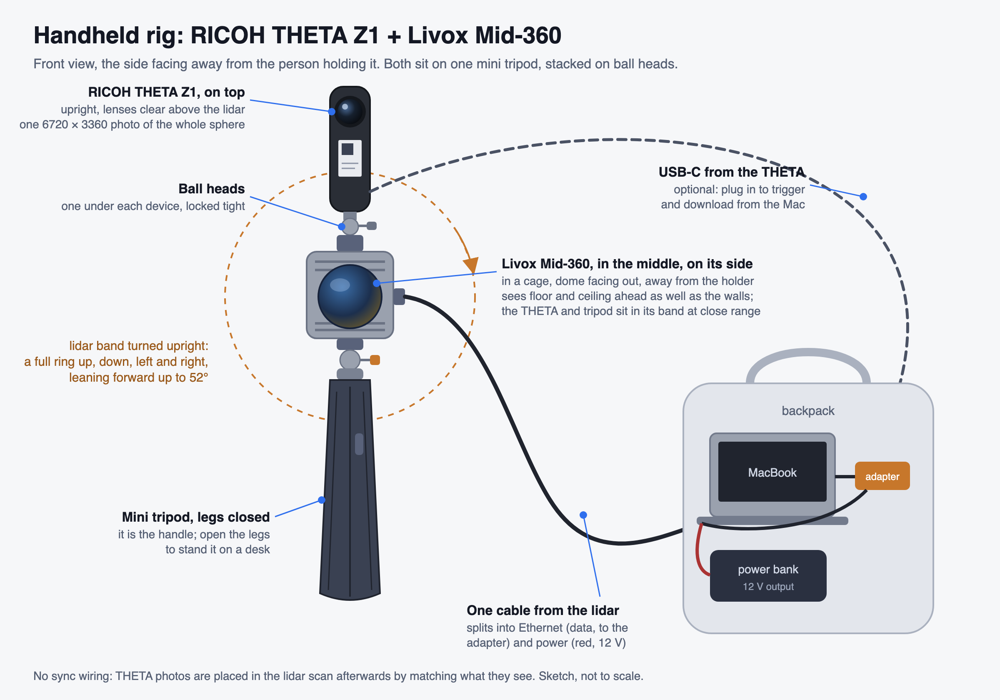

# Livox Mid-360 on a Mac

Python scripts that talk to a Livox Mid-360 lidar over Ethernet: no Livox SDK, no ROS. From "is it alive?" to a
coloured 3D map of a room.


**[Open the interactive 3D viewers](https://prasanthsasikumar.github.io/livox-mid360-mac/)**

[](https://prasanthsasikumar.github.io/livox-mid360-mac/room-mesh.html?ceiling=off)

| Stitched cloud | Mesh, from inside |
|---|---|
| [](https://prasanthsasikumar.github.io/livox-mid360-mac/cloud.html) | [](https://prasanthsasikumar.github.io/livox-mid360-mac/room-mesh.html?view=in) |

| Coloured from photos | Seen from above |
|---|---|
| [](https://prasanthsasikumar.github.io/livox-mid360-mac/colour-cloud.html?view=in) | [](https://prasanthsasikumar.github.io/livox-mid360-mac/colour-cloud.html) |

| Top-down density | Cleaned room |
|---|---|
|  | [](https://prasanthsasikumar.github.io/livox-mid360-mac/room-cloud.html?view=top) |

## Setup

- Mid-360 connected by Ethernet. Computer at `192.168.1.50`, lidar at `192.168.1.119` (change with `--host` / `--lidar`).
- Python 3.9+:

```sh
python3 -m venv .venv
.venv/bin/pip install -r requirements.txt
```

## Basic workflow

```sh
python3 livox_probe.py                          # check the sensor
python3 livox_cloud.py --seconds 3              # still scan
python3 livox_record.py --seconds 75            # record while moving
.venv/bin/python livox_stitch.py                # stitch (add --method lio for lidar+IMU)
.venv/bin/python livox_room.py                  # crop and clean
.venv/bin/python livox_mesh.py scans/<name>-stitched-room.ply --smooth 8 --trim 0.02
```

Move slowly, tilt a little, and finish where you started.

## Colour from photos

```sh
.venv/bin/python livox_photos.py "~/Downloads/office images" scans/<name>-stitched.ply --name office
.venv/bin/python livox_colour.py scans/<name>-stitched.ply --photos photos/office
```


## Phone rig

| Idea | As built |
|---|---|
|  |  |

```sh
python3 livox_record.py --seconds 75 --phone
.venv/bin/python livox_stitch.py recordings/walk-<time>.lvraw
.venv/bin/python livox_photos.py recordings/walk-<time>.mov scans/walk-<time>-stitched.ply \
    --name my-walk --poses scans/walk-<time>-stitched-poses.csv
.venv/bin/python livox_colour.py scans/walk-<time>-stitched.ply --photos photos/my-walk
```

## 360 camera rig

| Idea | As built |
|---|---|
|  |  |

```sh
brew install gphoto2
python3 livox_record.py --seconds 60 --theta --theta-every 15
.venv/bin/python livox_stitch.py recordings/walk-<time>.lvraw
.venv/bin/python livox_pano.py recordings/walk-<time>.lvraw
```

### Live view

```sh
.venv/bin/python livox_live.py          # http://localhost:8360
```

### Gaussian splat

```sh
.venv/bin/python livox_splat.py scans/live-<time>-map-colour.ply
```

## Limits

- Tested with one Mid-360 on one Mac.
- No loop closure: long walks drift.
- Range noise is 2–3 cm; small objects become blobs.
- Protocol details came from [Livox-SDK2](https://github.com/Livox-SDK/Livox-SDK2).
