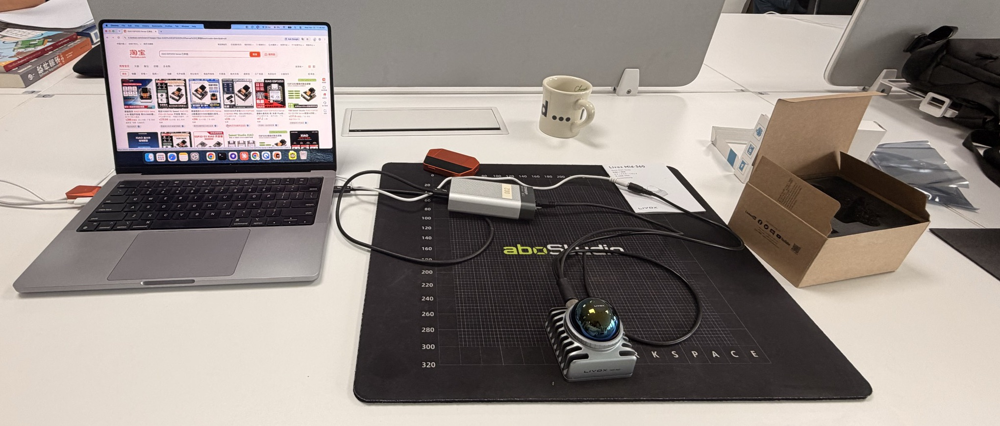
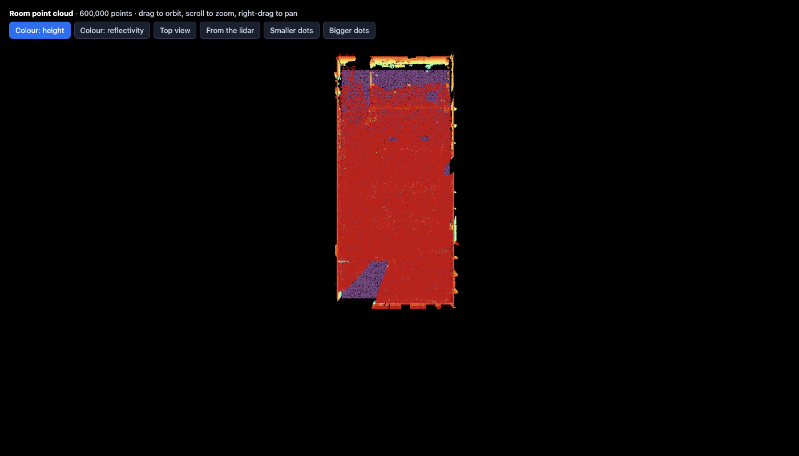
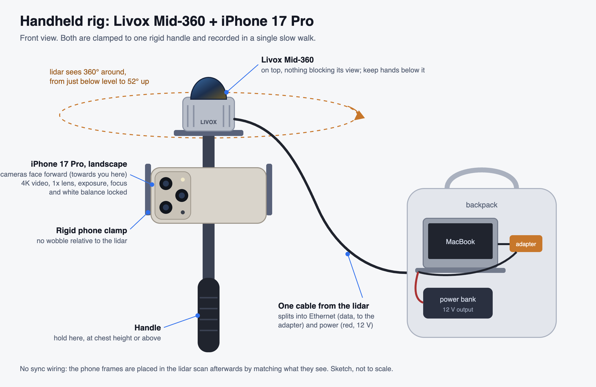
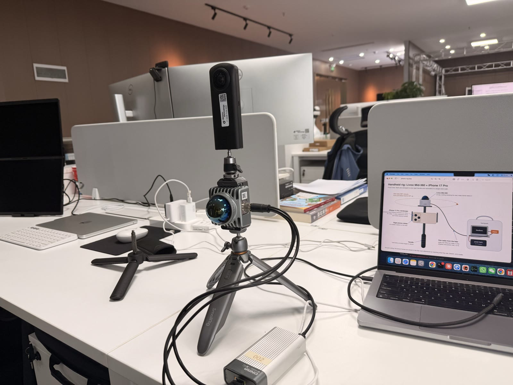

# Livox Mid-360 on a Mac

Python scripts that talk to a Livox Mid-360 lidar over Ethernet: no Livox SDK, no ROS. They take you from
"is the sensor alive?" to a stitched, cleaned and coloured 3D model of a room.



*The whole setup: a MacBook, a Thunderbolt-to-Ethernet adapter and the Mid-360 on its own power supply.*

**[Open the interactive 3D viewers](https://prasanthsasikumar.github.io/livox-mid360-mac/)** (drag to orbit, scroll to zoom).

[](https://prasanthsasikumar.github.io/livox-mid360-mac/room-mesh.html?ceiling=off)

The example is a 10 × 21.5 m hall, scanned in 75 seconds by lifting and tilting the lidar around a table.

| Stitched cloud, coloured by height | Mesh, from the lidar's position |
|---|---|
| [](https://prasanthsasikumar.github.io/livox-mid360-mac/cloud.html) | [](https://prasanthsasikumar.github.io/livox-mid360-mac/room-mesh.html?view=in) |

| Coloured from 26 iPhone photos | Seen from above |
|---|---|
| [](https://prasanthsasikumar.github.io/livox-mid360-mac/colour-cloud.html?view=in) | [](https://prasanthsasikumar.github.io/livox-mid360-mac/colour-cloud.html) |

| Top-down density | Cleaned room cloud |
|---|---|
|  | [](https://prasanthsasikumar.github.io/livox-mid360-mac/room-cloud.html?view=top) |

## Setup

- A Livox Mid-360, powered and connected by Ethernet (a USB or Thunderbolt adapter is fine).
- The computer's wired port on a fixed address. The scripts assume `192.168.1.50` for the computer and
  `192.168.1.119` for the lidar; use `--host` and `--lidar` if yours differ.
- Python 3.9 or newer:

```sh
python3 -m venv .venv
.venv/bin/pip install -r requirements.txt
```

## Scanning a room

**1. Check the sensor.** A healthy Mid-360 reports about 200,000 points per second.

```sh
python3 livox_probe.py
```

**2. Take a still scan.** Keep the lidar still; output goes to `scans/`.

```sh
python3 livox_cloud.py --seconds 3
```

**3. Record while moving.** Wait for `WALK` on the status line, then move. Recordings go to `recordings/`.

```sh
python3 livox_record.py --seconds 75
```

- Start with the lidar resting, untouched.
- Move slowly: 2–3 seconds for a quarter turn.
- Change height and tilt gently so it sees the floor and ceiling.
- Finish where you started.

**4. Stitch** the recording into one cloud. `icp` (default) uses points only; `lio` also uses the motion sensor.

```sh
.venv/bin/python livox_stitch.py
.venv/bin/python livox_stitch.py --method lio
```

**5. Crop to the room and clean up.** Use `--box XMIN XMAX YMIN YMAX` if it picks the wrong walls.

```sh
.venv/bin/python livox_room.py
```

**6. Make a mesh.**

```sh
.venv/bin/python livox_mesh.py scans/<name>-stitched-room.ply --smooth 8 --trim 0.02
```

## Colour from photos

The lidar has no camera, so colour comes from ordinary photos. `livox_photos.py` works out where each photo
was taken (using [COLMAP](https://colmap.github.io/)), then `livox_colour.py` paints the points.

```sh
.venv/bin/python livox_photos.py "~/Downloads/office images" scans/<name>-stitched.ply --name office
.venv/bin/python livox_colour.py scans/<name>-stitched.ply --photos photos/office
```


Overlap neighbouring shots heavily, keep one lens with no zoom, and get some floor in view.

## Phone rig

Lidar on top, phone below, one handle.

| Idea | As built |
|---|---|
|  |  |

`--phone` starts the LidarCam app (`phone-app/`) together with the lidar and downloads the video afterwards.

```sh
python3 livox_record.py --seconds 75 --phone
.venv/bin/python livox_stitch.py recordings/walk-<time>.lvraw
.venv/bin/python livox_photos.py recordings/walk-<time>.mov scans/walk-<time>-stitched.ply \
    --name my-walk --poses scans/walk-<time>-stitched-poses.csv
.venv/bin/python livox_colour.py scans/walk-<time>-stitched.ply --photos photos/my-walk
```

## 360 camera rig

A RICOH THETA Z1 on top, with the lidar on its side so it sees floor, walls and ceiling.

| Idea | As built |
|---|---|
|  |  |

Take a 360 photo every 15 seconds while recording, then colour the cloud from them:

```sh
brew install gphoto2
python3 livox_record.py --seconds 60 --theta --theta-every 15
.venv/bin/python livox_stitch.py recordings/walk-<time>.lvraw
.venv/bin/python livox_pano.py recordings/walk-<time>.lvraw
```

### Live view

Lidar and THETA video side by side in the browser. **Photo** colours the live points; **Map** builds a
coloured map as you walk; **Save** writes it to `scans/`.

```sh
.venv/bin/python livox_live.py          # opens http://localhost:8360
```

### Gaussian splat

Turn any photo-coloured cloud into a splat `.ply` for viewers such as [SuperSplat](https://superspl.at/editor):

```sh
.venv/bin/python livox_splat.py scans/live-<time>-map-colour.ply     # quick, from the live map
```

Trained from THETA stills, for real detail (needs [Brush](https://github.com/ArthurBrussee/brush); stop
`livox_live.py` first; tick = hold still, chime = move on):

```sh
python3 livox_record.py --theta --theta-every 12
.venv/bin/python livox_stitch.py recordings/walk-<time>.lvraw --no-open
.venv/bin/python livox_gsplat.py recordings/walk-<time>.lvraw        # then http://localhost:8360/splat
```

## What to expect

- Walls, floor, ceiling and large furniture come out well and to scale.
- Range noise is 2–3 cm, so surfaces are a little lumpy and small objects become blobs.
- Only what is in line of sight gets scanned; walk the room to fill gaps.
- No loop closure, so long walks drift.
- Tested with one Mid-360 on one Mac. Protocol details came from [Livox-SDK2](https://github.com/Livox-SDK/Livox-SDK2).
